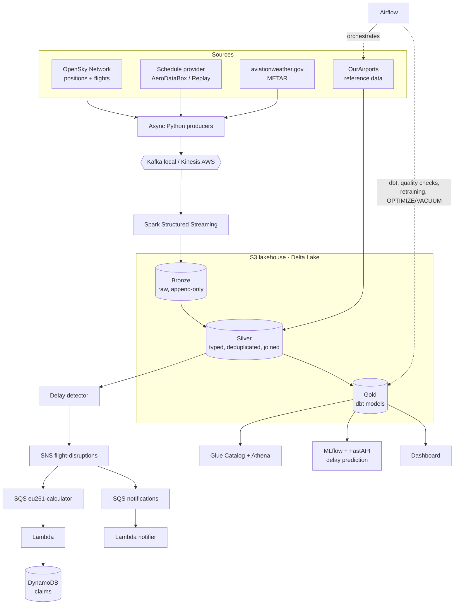

# SkyPulse

[](https://github.com/digomes87/SkyPulse/actions/workflows/ci.yml)

**Real-time flight disruption and EU261 exposure platform for European air traffic.**

SkyPulse ingests live aircraft positions over Europe, matches them against flight schedules,
detects delayed and cancelled flights in near real time and works out which of them are
eligible for compensation under **EU Regulation 261/2004**. Every flight is enriched with
airport weather (METAR) so that likely "extraordinary circumstances" are flagged, and a
delay prediction model scores upcoming departures. The end result is a lakehouse of curated
data models and a dashboard that answers one question:

> *Which European airports and routes delay the most, and how much would it cost in EU261 payouts?*

> **Status:** early development. The design below is the target architecture; the
> [roadmap](#roadmap) tracks what is already built.

---

## What it does

| # | Capability | Description |
|---|------------|-------------|
| 1 | **Live ingestion** | Polls aircraft state vectors over a European bounding box (OpenSky Network) and scheduled vs actual times from a schedule provider. |
| 2 | **Disruption detection** | Streaming job compares actual against scheduled times and emits `FlightDelayed` / `FlightCancelled` events within minutes. |
| 3 | **EU261 eligibility** | A pure, fully tested rules engine computes eligibility and compensation amount (EUR 250 / 400 / 600) per flight. |
| 4 | **Weather enrichment** | METAR observations at origin and destination flag likely extraordinary circumstances (thunderstorms, freezing precipitation, low visibility, strong crosswind). |
| 5 | **Delay prediction** | Gradient boosted model predicting arrival delay >= 15 min and >= 180 min, tracked in MLflow and served over FastAPI. |
| 6 | **Analytics** | dbt gold models (on-time performance, airport delay trends, EU261 exposure by airline) behind a storytelling dashboard. |

## Architecture



### Two run modes, one config switch

- **`local`**: everything runs in docker-compose: Kafka (KRaft), LocalStack (S3, SNS, SQS,
  Lambda, DynamoDB), Spark, Airflow, MLflow, Prometheus, Grafana, the model API and the
  dashboard. Recorded API responses in `data/fixtures/` are replayed, so the full pipeline
  runs offline and deterministically, including in CI.
- **`aws`**: Terraform deploys the same pipeline to real AWS (S3, Kinesis, SNS, SQS, Lambda,
  DynamoDB, Glue, Athena), with Databricks for notebooks and jobs. Designed to stay close to
  zero cost and to be torn down with a single command.

## Data sources

| Source | Used for | Notes |
|--------|----------|-------|
| [OpenSky Network](https://opensky-network.org/) REST API | Live positions (`/states/all`), historical departures and arrivals | OAuth2 client credentials, credit-based rate limits, backoff and credit tracking built in |
| [AeroDataBox](https://aerodatabox.com/) (RapidAPI) | Scheduled vs actual times | OpenSky has no schedules. Behind a `ScheduleProvider` interface with an offline `ReplayProvider` |
| [aviationweather.gov](https://aviationweather.gov/data/api/) Data API | METAR per airport | Polled per airport, backfilled in batch |
| [OurAirports](https://ourairports.com/data/) | Airports, ICAO/IATA codes, coordinates, country | Batch reference load |

Rate limits, authentication and terms for each source are documented in
[docs/data-sources.md](docs/data-sources.md). Event schemas live in [contracts/](contracts/).

More detail: [architecture](docs/architecture.md) and [decision records](docs/decisions/).

## EU261 rules (simplified)

The rules engine is a standalone library with no I/O, tested with property-based tests.

- **Scope:** flights departing an EU/EEA/UK/CH airport, or arriving there on an EU carrier.
- **Eligible** when arrival delay at the final destination is **>= 3 hours**, or the flight is
  cancelled with less than 14 days notice.
- **Amount** by great-circle distance:

  | Distance | Compensation |
  |----------|--------------|
  | <= 1500 km | EUR 250 |
  | Intra-EU > 1500 km, or other flights 1500 to 3500 km | EUR 400 |
  | > 3500 km (not intra-EU) | EUR 600 |

- **50% reduction** when re-routing keeps the arrival delay within the regulation thresholds.
- **`extraordinary_circumstances_likely`** is raised when METAR around the scheduled time shows
  severe weather. It is an analytical flag, **not a legal decision**.

## Quickstart

Requirements: Docker with Compose v2, [uv](https://docs.astral.sh/uv/), GNU Make.

```bash
git clone https://github.com/digomes87/SkyPulse.git
cd SkyPulse
cp .env.example .env
make install            # dependencies + git hooks
make up                 # Kafka + LocalStack, topics and buckets created
make test               # unit tests with coverage
make test-integration   # checks against the running stack
make down
```

| Service | URL |
|---------|-----|
| Kafka (from the host) | `localhost:9092` |
| LocalStack (AWS APIs) | `http://localhost:4566` |

Run the producers against recorded fixtures (no API keys needed):

```bash
export SKYPULSE_INGESTION__REPLAY=true
uv run python -m skypulse.ingestion states --cycles 1
uv run python -m skypulse.ingestion schedules --cycles 1
uv run python -m skypulse.ingestion metar --cycles 1
```

`make help` lists every target. The end-to-end `make demo` arrives with the streaming
milestones; see the [roadmap](#roadmap).

## Planned tech stack

| Area | Tools | Role in SkyPulse |
|------|-------|------------------|
| Ingestion | Python 3.12, asyncio, httpx, Pydantic | API clients and producers |
| Streaming | Kafka (KRaft), Amazon Kinesis | Event bus behind a `StreamSink` / `StreamSource` abstraction |
| Processing | Spark Structured Streaming, Databricks | Bronze and silver jobs, watermarks, deduplication |
| Storage | S3, Delta Lake | Medallion lakehouse with idempotent MERGE writes |
| Modelling | dbt | Gold dimensional models and tests |
| Events | SNS, SQS, Lambda, DynamoDB | Disruption fan-out and EU261 claim state |
| Orchestration | Airflow | Reference loads, backfills, dbt, quality, retraining, compaction |
| Data quality | Great Expectations | Contracts on bronze to silver and on gold |
| ML | LightGBM, MLflow, FastAPI | Training, registry, online prediction |
| Observability | Prometheus, Grafana, structured JSON logs | Lag, throughput, freshness, DLQ depth |
| Infrastructure | Terraform, Docker, GitHub Actions | AWS provisioning, local stack, CI/CD |
| Query | Glue Data Catalog, Athena | Ad hoc SQL on the lakehouse |

## Repository layout

```
contracts/            event schemas (JSON Schema / Avro)
src/skypulse/
  ingestion/          OpenSky, schedule and METAR clients and producers
  streaming/          Spark Structured Streaming jobs
  eu261/              pure rules engine
  lambdas/            EU261 calculator and notifier
  ml/                 features, training, serving
  common/             config, logging, metrics, stream abstractions
dbt/                  gold models and tests
airflow/dags/         batch orchestration
quality/              data quality suites
infra/terraform/      AWS modules
observability/        Prometheus and Grafana provisioning
dashboard/            storytelling dashboard
data/fixtures/        recorded API responses for replay mode
notebooks/            exploration and insights
docs/                 architecture, data sources, ADRs, runbooks, model card
tests/                unit and integration tests
```

## Roadmap

| Milestone | Scope | Status |
|-----------|-------|--------|
| M1 Foundation | Repo skeleton, tooling, CI, docker-compose (Kafka + LocalStack), config and logging | Done |
| M2 Ingestion | OpenSky, schedule and METAR clients, producers, contracts, fixtures | Done |
| M3 Streaming lakehouse | Bronze/silver Delta jobs, watermarks, dedup, MERGE, end-to-end test | Planned |
| M4 EU261 + events | Rules engine, delay detector, SNS/SQS/Lambda/DynamoDB, DLQs | Planned |
| M5 Batch and modelling | Airflow DAGs, reference data, dbt gold models, dbt docs | Planned |
| M6 Quality and observability | Great Expectations, anomaly checks, Prometheus, Grafana, runbooks | Planned |
| M7 ML | Features, training, MLflow, FastAPI serving, retraining DAG, model card | Planned |
| M8 AWS + Databricks | Terraform modules, Kinesis mode, Glue/Athena, cost doc | Planned |
| M9 Storytelling | Dashboard, notebooks, screenshots, demo | Planned |

## Development workflow

```
feature/*, fix/*, docs/*, ci/*  ──PR──▶  develop  ──CI green──▶  main
```

- Work happens on short-lived branches cut from `develop`.
- Every change reaches `develop` through a pull request; the `checks` status must pass before
  it can merge (auto-merge is enabled).
- When CI passes on a push to `develop`, the `Promote to main` workflow fast-forwards `main` to
  that exact commit. `main` therefore only ever contains tested code, and force pushes and
  deletions are blocked on both long-lived branches.
- Commit messages follow [Conventional Commits](https://www.conventionalcommits.org/).
